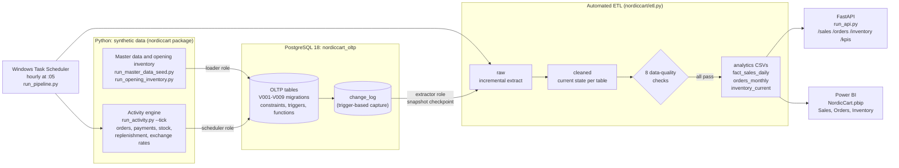
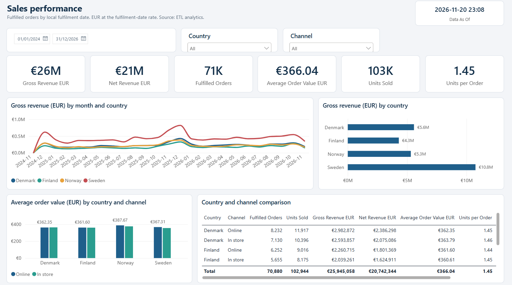
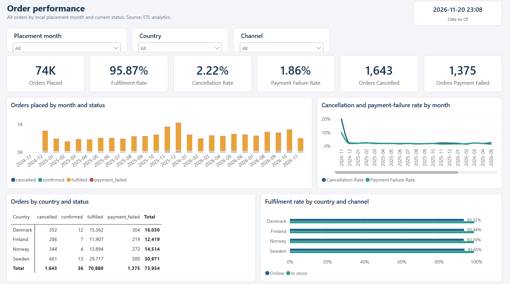
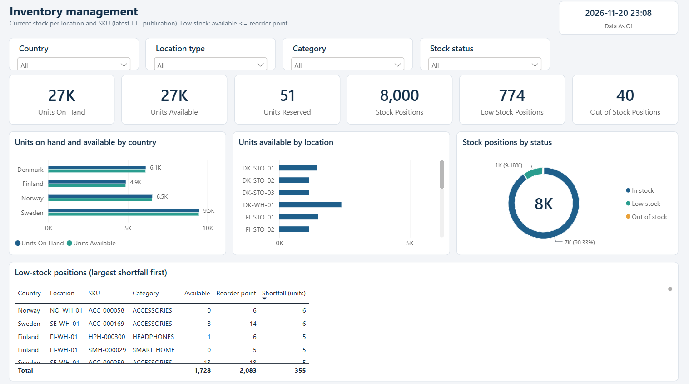

# NordicCart Data Pipeline

An end-to-end data engineering project for **NordicCart**, a fictional omnichannel retailer with 12 stores, 4 warehouses and an online shop in Sweden, Norway, Denmark and Finland.

- **Database:** a production-style PostgreSQL OLTP database, built through versioned migrations.
- **Data:** a deterministic Python simulation writes two years of orders, payments, stock movements, replenishment and exchange rates, then keeps generating new activity every hour.
- **Automation:** an hourly pipeline runs the simulation and then an incremental, quality-checked ETL into analytics files.
- **Consumers:** a read-only FastAPI service and a three-page Power BI report read those files, and their figures reconcile exactly.

> All data is synthetic. Customer names, addresses and e-mail addresses (`example.com`/`.net`/`.org`) are generated; no real person or company is represented.

## Key features

- **Transactional database design:** 9 forward-only migrations (V001–V009).
  - **Integrity:** constraints, triggers and stored functions enforce the business rules; the order life cycle and the stock ledger are enforced *in the database*, not only in application code.
  - **Change capture:** every change is recorded in `change_log`.
  - **Least privilege:** 7 roles (owner, writer, reader, loader, scheduler, analyst, extractor).
- **Reproducible simulation:** the same seed gives the same data, down to SHA-256 fingerprints.
  - **Scale:** 500 products, 20,000 customers, 8,000 stock positions, and about 74,000 orders over 2024-11-01 to today, with demand seasonality, Black Week, store opening hours, payment failures, cancellations, (s, S) replenishment and multi-currency pricing.
  - **Safe writing:** each unit of work is one transaction, verified against an independent replay; a run can be resumed after a crash.
- **Hourly automation:** Windows Task Scheduler runs `run_pipeline.py` at minute 5 of every hour.
  - **Generation:** an engine tick generates the hours since the last verified window (missed hours are caught up).
  - **ETL:** an incremental extract from `change_log`, using a snapshot checkpoint, refreshes three layers: **raw → cleaned → analytics**.
  - **Quality gate:** analytics are published only when all **8 data-quality checks** pass, with atomic file replacement.
- **Read-only analytics API (FastAPI):** sales, orders, inventory and KPI endpoints, with filtering and paging, OpenAPI documentation, and freshness information on `/health`.
- **Power BI report (PBIP, stored as text):**
  - **Content:** Sales, Orders and Inventory pages with a star-schema model, 35 DAX measures, like-for-like year-on-year comparison, and local-currency revenue that is never summed across currencies.
  - **Reconciliation:** 77 of 77 checks against FastAPI and independent recalculation.
- **Evidence-based delivery:** every stage was tested on a disposable sandbox server before touching the real database.
  - **Tests:** 554 pytest tests, plus SQL test suites and 18 SQL verification scripts.
  - **Reports:** a report per stage in [`docs/test_reports/`](docs/test_reports/).

## Architecture



| Layer | What it does | Main code |
|---|---|---|
| Database | Schema, business rules, change capture, roles | [`database/migrations/`](database/migrations/) |
| Data generation | Master data, opening stock, pilot scenarios, then the combined activity engine (demand model, order life cycle, replenishment, price changes, exchange rates) | [`python/nordiccart/`](python/nordiccart/), `python/run_*.py` |
| Orchestration | OS lock (one run at a time), retries for transient failures, daily log and one JSON line per run | [`python/run_pipeline.py`](python/run_pipeline.py), [`python/run_pipeline_hourly.cmd`](python/run_pipeline_hourly.cmd) |
| ETL | `change_log` extract → cleaned current state (idempotent by `change_id`) → data-quality gate → analytics | [`python/nordiccart/etl.py`](python/nordiccart/etl.py) |
| API | Read-only service over the published analytics; reloads a file when it changes | [`python/nordiccart/api.py`](python/nordiccart/api.py) |
| BI | Power BI project generated from one specification | [`powerbi/`](powerbi/) |

The API and Power BI read the **same published files**, never the OLTP database, so they always show the same numbers and the database carries no reporting load.

## Technology stack

| Area | Technology |
|---|---|
| Database | PostgreSQL 18 (PL/pgSQL functions and triggers, enums, partial and unique indexes, role-based security) |
| Language | Python 3.10–3.14 (developed and tested on 3.14) |
| Python libraries | psycopg 3, FastAPI, Uvicorn, Pydantic, pytest, httpx, tzdata |
| Scheduling | Windows Task Scheduler |
| BI | Power BI Desktop: Power BI Project (PBIP), TMDL semantic model, PBIR report, DAX, Power Query (M) |
| Design and tools | DBML schema design, Valentina Studio / psql, VS Code |

## Dashboards

The report has three pages. Each has country, channel and date (or location and category) slicers, and a "Data As Of" card that shows when the ETL published the files.

**Sales performance:** revenue (gross, net, VAT), fulfilled orders, average order value, units per order, monthly trend with like-for-like year on year, revenue by country and channel.



**Order performance:** placed orders, fulfilment, cancellation and payment-failure rates, the status mix by month and country.



**Inventory management:** units on hand, reserved and available, low-stock and out-of-stock positions by location and category, and a low-stock table with the shortfall against the reorder point.



Every measure and its formula: [`powerbi/MEASURES.md`](powerbi/MEASURES.md).

## Repository structure

```
NordicCart_Data_Pipeline/
├── README.md
├── .gitignore                       secrets, backups, logs, generated data and local state are excluded
├── config/
│   ├── .env.example                 connection template (copy to config/.env, which is git-ignored)
│   ├── generator.toml               simulation settings: seed, sizes, calendar, demand, inventory, replenishment
│   └── README.md
├── database/
│   ├── design/                      DBML schema design (revision 4, revision 3, archive)
│   ├── setup/00_create_database.sql
│   ├── migrations/                  V001–V009 (forward-only, one transaction each)
│   ├── rollback/                    R008, R009
│   ├── security/                    re-apply V008 database privileges after a restore
│   └── README.md                    schema, business rules and migration conventions
├── python/
│   ├── nordiccart/                  the package
│   │   ├── master_data/  inventory/  transactions/  replenishment/   generators, validators, loaders
│   │   ├── demand/                  demand model and calibration
│   │   ├── activity/                combined activity engine (plan, run, verify, checkpoints)
│   │   ├── units/  stock/           units of work and the shared stock ledger
│   │   ├── reference_data/          markets, locations, catalogue rules, names (JSON)
│   │   ├── etl.py                   raw → cleaned → data-quality gate → analytics
│   │   ├── api.py                   FastAPI application
│   │   └── settings.py, exchange_rates.py, logging_setup.py
│   ├── run_*.py                     command-line entry points
│   ├── run_pipeline.py              hourly orchestrator (generation tick + ETL)
│   ├── run_pipeline_hourly.cmd      Task Scheduler launcher
│   ├── register_hourly_task.ps1     registers the scheduled task (disabled)
│   ├── setup_pipeline_credentials.ps1  creates the scheduler and extractor credentials (git-ignored files)
│   └── requirements.txt
├── powerbi/
│   ├── NordicCart.pbip              open this in Power BI Desktop
│   ├── NordicCart.SemanticModel/    TMDL: tables, Power Query, relationships, DAX measures
│   ├── NordicCart.Report/           PBIR: 3 pages, 46 visuals, theme
│   ├── build_pbip.py                generates the model and report from one specification
│   ├── MEASURES.md, README.md
│   └── screenshots/
├── sql/verification/                18 read-only verification scripts (PASS / INFO / WARN / FAIL rows)
├── tests/
│   ├── python/                      pytest suites (unit tests; database tests run only on a sandbox)
│   └── sql/                         SQL behaviour tests for V006–V009
├── docs/                            guides, design documents and stage reports (docs/test_reports/)
└── .vscode/launch.json              VS Code run configurations
```

Created at run time and **not** committed: `config/.env*` (credentials), `database/backups/`, `logs/`, `output/` (all generated data, including the analytics files) and `.venv/`.

## Setup

### Prerequisites

- Windows 10 or 11 (the scheduler and launch scripts are PowerShell / `cmd`; the Python code itself is cross-platform)
- PostgreSQL 18 with `psql` (`C:\Program Files\PostgreSQL\18\bin`)
- Python 3.10 or later
- Power BI Desktop (Microsoft Store version 2.159 or later) for the report

### 1. Python environment

```powershell
python -m venv .venv
.\.venv\Scripts\python.exe -m pip install -r python\requirements.txt
```

### 2. Database

Run these as the `postgres` superuser; `psql` asks for the password. Never put a password on a command line or in a file in the repository.

```powershell
$bin = "C:\Program Files\PostgreSQL\18\bin"
& "$bin\psql.exe" -h localhost -U postgres -d postgres -v ON_ERROR_STOP=1 -f database\setup\00_create_database.sql
Get-ChildItem database\migrations\V*.sql | Sort-Object Name | ForEach-Object {
    & "$bin\psql.exe" -h localhost -U postgres -d nordiccart_oltp -v ON_ERROR_STOP=1 -f $_.FullName
    if ($LASTEXITCODE -ne 0) { throw "$($_.Name) failed" }
}
```

Each migration checks its predecessor, runs in one transaction and records itself in `meta.schema_migrations`. V008 creates the seven roles without passwords. Give the loader (and, if you want read-only SQL access, the analyst) a password in `psql`:

```
\password nordiccart_loader
\password nordiccart_analyst
```

Step-by-step guidance in Valentina Studio: [`docs/phase2_valentina_studio_execution_guide.md`](docs/phase2_valentina_studio_execution_guide.md).

### 3. Connection settings

Copy `config/.env.example` to `config/.env` and set `PGUSER=nordiccart_loader` and its password. `config/.env` is git-ignored. The tools log only the variable names, never the values. A variable already set in the terminal takes precedence over the file.

### 4. Load the baseline data

Each loader validates its data first. `--plan` is read-only. `--apply` writes in verified transactions and asks you to type the database name to confirm.

```powershell
$py = ".\.venv\Scripts\python.exe"
# pilot scenarios (20 products, 100 customers, 20 hand-designed orders, replenishment pilot, exchange rates)
& $py python\run_master_data_seed.py --apply
& $py python\run_opening_inventory.py --apply
& $py python\run_transactions.py --apply
& $py python\run_replenishment.py --apply
& $py python\run_exchange_rates.py --apply
# full business scale (500 products, 20,000 customers, demand-calibrated opening stock)
& $py python\run_master_data_seed.py --profile full --apply
& $py python\run_opening_inventory.py --profile full --apply
```

This is the order in which the real database was built. Each step and its expected counts are documented in the guides in [`docs/`](docs/) and in [`docs/phase2_database_implementation_status.md`](docs/phase2_database_implementation_status.md).

### 5. Historical simulation (2024-12-03 onwards)

The activity engine has a **write guard** and refuses any database it has not been explicitly allowed to write to (exit code 3, nothing written).

- **Sandbox mode:** set `NORDICCART_S6_SANDBOX=1` and `NORDICCART_S6_SANDBOX_CLUSTER` to the server's `SELECT system_identifier FROM pg_control_system()`. In this mode the engine also refuses the database named in `config/.env`, so pass the target with `--env-file`.
- **Authorized production target:** the server must be listed in `PROTECTED_CLUSTERS` ([`python/nordiccart/activity/run.py`](python/nordiccart/activity/run.py)), and `NORDICCART_S9_REAL_AUTHORIZED=<cluster id>/<database>` must name it exactly. In this repository both are pinned to the original server's cluster identifier, as are [`python/run_pipeline_hourly.cmd`](python/run_pipeline_hourly.cmd), [`python/setup_pipeline_credentials.ps1`](python/setup_pipeline_credentials.ps1) and [`python/s9_catch_up.py`](python/s9_catch_up.py). On a new server, replace that identifier with your own in those places.

Then catch up to the current hour. The first run replays and verifies every day since 2024-12-03 and runs a month-end verification for each month. That takes roughly an hour; later runs take seconds.

```powershell
& $py python\run_activity.py --plan                        # read-only: the next window and its checks
& $py python\run_activity.py --tick --yes --profile full   # every window up to the current hour
```

The original deployment used [`python/s9_catch_up.py`](python/s9_catch_up.py), which runs the same engine month by month and takes a `pg_dump` recovery point after each month. The engine is deterministic: the real deployment reproduced the sandbox rehearsal's plan fingerprints and state hashes exactly.

## Hourly scheduling

1. **Credentials for the pipeline roles.** Run this once in a local terminal:
   ```powershell
   powershell -NoProfile -ExecutionPolicy Bypass -File python\setup_pipeline_credentials.ps1
   ```
   You type the `postgres` password; it is not shown or stored. The script gives `nordiccart_scheduler` and `nordiccart_extractor` random passwords and checks that both can log in. It writes `config/.env.scheduler` and `config/.env.extractor`, which are git-ignored and readable only by you.
2. **One supervised run:** `python\run_pipeline_hourly.cmd`. Check `logs/pipeline/pipeline_<date>.log` and `logs/pipeline/runs.jsonl`.
3. **Register and enable the task:**
   ```powershell
   powershell -NoProfile -ExecutionPolicy Bypass -File python\register_hourly_task.ps1   # registers it disabled
   Enable-ScheduledTask -TaskName "NordicCart Hourly Pipeline"
   ```
   The task runs every hour at minute 5 as the current user. It allows no overlapping instances and has a 50-minute time limit.

What each run does:

| Step | Detail |
|---|---|
| Lock | One pipeline at a time (an OS lock in `logs/pipeline/`) |
| Generation | `run_activity.py --tick`: every window from the last verified one to the current hour. An hour already verified writes nothing. A failed or interrupted run is resumed. The month-end verification runs at 00:00 on the 1st |
| ETL | As `nordiccart_extractor`: an incremental `change_log` extract (raw), then the cleaned current state, the 8 data-quality checks and, only if all pass, the analytics files. Each file is written to a temporary file and swapped in with `os.replace`; on Windows the swap is retried briefly while a reader has the file open |
| Evidence | A daily log and one JSON line per run (`logs/pipeline/runs.jsonl`). Exit 0 means success |

To pause the pipeline, run `Disable-ScheduledTask -TaskName "NordicCart Hourly Pipeline"`. To run it manually with an explicit clock:

```powershell
& $py python\run_pipeline.py --env-file config\.env.scheduler --etl-env-file config\.env.extractor [--now 2026-11-02T13:05:00Z]
```

## API usage

```powershell
& $py python\run_api.py                 # http://127.0.0.1:8000  (options: --host, --port, --analytics-dir)
```

Interactive documentation is at `http://127.0.0.1:8000/docs` (Swagger UI) and `/redoc`. The API has no authentication and is **read-only**, so it listens on localhost unless you pass `--host`.

| Endpoint | Returns | Filters |
|---|---|---|
| `GET /health` | Status, row count and publication time of each analytics file, and the last pipeline run | – |
| `GET /sales/daily` | Daily fulfilled sales by country, channel and currency (local and EUR) | `country`, `channel`, `date_from`, `date_to`, `limit`, `offset` |
| `GET /orders/monthly` | Orders placed per month by country, channel and status | `country`, `channel`, `status`, `month_from`, `month_to`, `limit`, `offset` |
| `GET /inventory/current` | Current stock per location and SKU, with a low-stock flag | `country`, `location_type`, `location_code`, `category`, `sku`, `low_stock`, `limit`, `offset` |
| `GET /kpis` | Sales, order and inventory KPIs for a period, plus sales by country | `country`, `channel`, `date_from`, `date_to` |

```powershell
Invoke-RestMethod "http://127.0.0.1:8000/kpis?country=SE&channel=online&date_from=2026-10-01&date_to=2026-10-31"
Invoke-RestMethod "http://127.0.0.1:8000/inventory/current?low_stock=true&country=FI&limit=50"
curl.exe "http://127.0.0.1:8000/orders/monthly?status=cancelled&month_from=2026-01"
```

The API returns 400 for an unknown country or status, or a reversed date range; 422 for an invalid parameter; and 503 while an analytics file is missing. It reloads a file as soon as the hourly ETL replaces it.

## Power BI refresh

1. Open [`powerbi/NordicCart.pbip`](powerbi/NordicCart.pbip) in Power BI Desktop.
2. Point the data folder at your clone. Power Query has no relative paths, so the committed project uses the neutral placeholder `C:\NordicCart_Data_Pipeline\output\etl\analytics`. Either:
   - in Desktop, choose **Transform data → Edit parameters → AnalyticsFolder** and enter `<your clone>\output\etl\analytics`; or
   - run `python powerbi\build_pbip.py --local`, which regenerates the project with your clone's folder. Run `python powerbi\build_pbip.py` (no option) again before committing.
3. Choose **Refresh** (about 10 seconds), then **Save**.
4. After an hourly run, choose **Refresh** again. The **Data As Of** card shows the ETL publication time, the same value as `/health` in the API.

A scheduled refresh in the Power BI Service would need a workspace and an on-premises data gateway; it is not part of this project. Details: [`powerbi/README.md`](powerbi/README.md).

## Testing and verification

```powershell
& $py -m pytest tests\python -q    # unit tests; database suites are skipped unless enabled
```

- **Database tests** create and drop their own databases (`nordiccart_*_test_*`) and never connect to `nordiccart_oltp`. Enable them with `NORDICCART_DB_TESTS=1` against a disposable server: [`tests/README.md`](tests/README.md).
- **SQL verification:** `sql/verification/01`–`18` are read-only and return PASS / INFO / WARN / FAIL rows for the schema, data and business rules: [`sql/README.md`](sql/README.md).
- **Stage reports** with the evidence for every step (sandbox tests, deployments, reconciliation): [`docs/test_reports/`](docs/test_reports/).

## Security

- **No credentials in the repository.** Connection settings live in git-ignored `config/.env*` files; only the template `config/.env.example` is committed. SQL scripts contain no passwords. The Python tools never log password values, and tests check this.
- **Least privilege.**
  - **Loader:** loads data.
  - **Scheduler:** generates activity, with a statement timeout.
  - **Extractor:** reads only what the ETL needs.
  - **Analyst:** read-only.
  - Nothing is granted to `PUBLIC`.
- **Guarded writes.** The activity engine writes only to an explicitly authorized server and database. Every loader is idempotent and verifies what it wrote before committing.
- **Not committed:** database backups (`*.dump`), logs, generated data, local Power BI settings and caches, and the virtual environment.

## Documentation

| Document | Contents |
|---|---|
| [`database/README.md`](database/README.md) | Schema, business rules, migration conventions |
| [`docs/phase3_combined_activity_design.md`](docs/phase3_combined_activity_design.md) | Design of the combined activity simulation |
| [`docs/phase2_database_implementation_status.md`](docs/phase2_database_implementation_status.md) | Stage-by-stage implementation status |
| [`docs/test_reports/S10_hourly_pipeline_report.md`](docs/test_reports/S10_hourly_pipeline_report.md) | Hourly pipeline and ETL |
| [`docs/test_reports/FastAPI_implementation_report.md`](docs/test_reports/FastAPI_implementation_report.md) | API implementation and evidence |
| [`docs/test_reports/PowerBI_dashboard_report.md`](docs/test_reports/PowerBI_dashboard_report.md) | Power BI model, measures, validation and refresh |
| [`docs/test_reports/Project_completion_report.md`](docs/test_reports/Project_completion_report.md) | Final project summary |

## Project figures (2026-11-22, all data to date)

| | |
|---|---|
| Orders placed / fulfilled | 74,090 / 71,035 (fulfilment rate 95.9 %, cancellation rate 2.2 %) |
| Fulfilled revenue | €26.0 M gross, €20.8 M net |
| Average order value | €365.97 gross |
| Stock positions | 8,000 (16 locations × 500 products), 893 at or below the reorder point |
| Hourly runs | exit 0, 8/8 data-quality checks, about 1 minute each |
